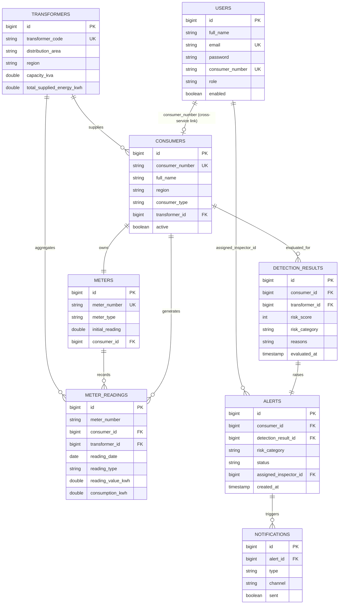

# PhantomExpose — Entity Relationship Diagram

## Design notes

- **Database-per-service**: each microservice owns its schema (`phantomexpose_auth`, `_consumer`, `_meter`, `_detection`, `_notification`). Cross-service references (e.g. `consumer_id` in `meter_readings`) are logical foreign keys resolved via REST/Feign calls, not physical DB foreign keys, since services do not share a database in production. The `analytics-service` is the one exception that reads directly off the `phantomexpose_detection` database for query performance — an accepted CQRS-style trade-off for a dashboard that needs cheap aggregate reads.
- **Indexing strategy**: composite indexes are placed on `(meter_number, reading_date)` and `(consumer_id, reading_date)` in `meter_readings` since the detection engine's hot path is "get last N readings for a consumer ordered by date." `alerts.status` and `alerts.assigned_inspector_id` are indexed to support the inspector's worklist queries. `detection_results.risk_category` supports fast dashboard aggregation.
